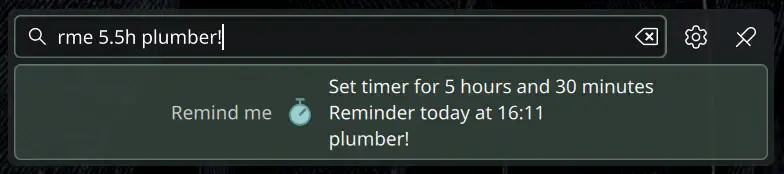
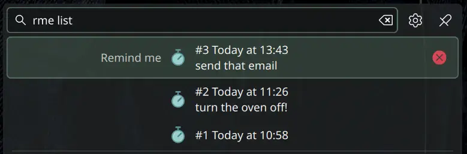
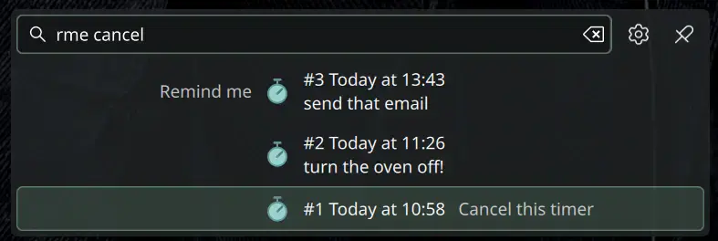
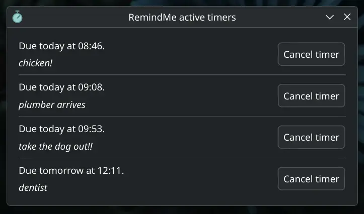
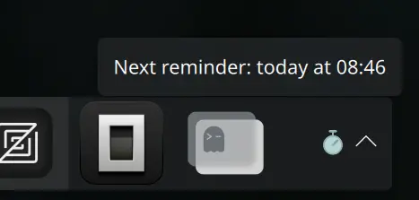

# RemindMe

A timer plugin for KDE Plasma 6 to create, list, and cancel timers from KRunner with optional message and snooze.








## Install

From the KDE Store, inside KRunner:

1. Open *System Settings → Search → Plasma Search*.
2. Click *Get New Plugins…*.
3. Search for *RemindMe* and click *Install*.
4. Restart KRunner: `pkill -f '[k]runner-remindme'; systemctl --user restart plasma-krunner.service`.

> [!NOTE]
> Optionally, make RemindMe a favorite and move it above others via *System Settings → Search → Plasma Search*.

### From the release archive

```sh
mkdir -p ~/.local/share/krunner-sources
tar xzf remindme-<version>.tar.gz -C ~/.local/share/krunner-sources
krunner-plugininstaller install ~/.local/share/krunner-sources/remindme-<version>
pkill -f '[k]runner-remindme'; systemctl --user restart plasma-krunner.service
```

Keep the extracted directory: the D-Bus service runs the launcher inside it. Pass the exact version path, not a glob; `krunner-plugininstaller` takes one path.

### Uninstall

Uninstall the plugin from *Get New Plugins…*, then restart KRunner. Timers are stored separately: they stay in `~/.local/share/krunner-remindme`, delete that directory to start empty.

---

## Usage

Trigger words: `remindme` or `rme`.

| Action                | Query                 |
| --------------------- | --------------------- |
| Create timer          | `rme 5`, `rme 3h msg` |
| List active timers    | `rme`, `rme list`     |
| Cancel by id          | `rme cancel 3`        |
| Cancel by message     | `rme cancel meeting`  |
| List timers to cancel | `rme cancel`          |

A ringing alarm that has not been snoozed or dismissed yet is listed by `rme list` and `rme cancel`, so it can be acknowledged from KRunner without finding its window.

Snooze re-arms the alarm after the minutes shown in its spin box (default 1, up to 1440).

Selecting a listed timer opens one *Reminders* window with every active timer, each row with its due time and a *Cancel timer* button.

While any timer waits, a tray icon appears too: clicking it opens the same *Reminders* window, and its tooltip shows when the next reminder is due.

| Input          | Meaning                             |
| -------------- | ----------------------------------- |
| `rme 5`        | 5 minutes                           |
| `rme 5.5`      | 5 minutes 30 seconds                |
| `rme .5`       | 0.5 minutes = 30 seconds            |
| `rme 0:20`     | 20 seconds                          |
| `rme 20s`      | 20 seconds                          |
| `rme 4h`       | 4 hours                             |
| `rme 5:30`     | 5 minutes 30 seconds                |
| `rme 4:15:30`  | 4 hours 15 minutes 30 seconds       |
| `rme 8 pasta!` | 8 minutes with the message `pasta!` |

---

## Development

Requirements: C++20 compiler, CMake 3.29+, Qt 6.9+, KDE Frameworks 6.9+, Extra CMake Modules 6.9+, `gettext` and `just`. Tests also need Qt `Test`. `just package` needs podman or docker; `just release` needs `cog` and `gh`.

```sh
just                      # Verify the repo: lint, format check, then configure, build and test.
just ci                   # configure, build and test
just format               # Format C++ sources and shell scripts in place
just install              # install a built preset
just package              # build the KDE Store payload
just release              # bump, push, build the payload and publish the GitHub release
just reload               # install and restart KRunner with the local runner
```

Uninstall: `./packaging/uninstall.sh`

---

## License

[GPL-3.0-or-later](LICENSE).
