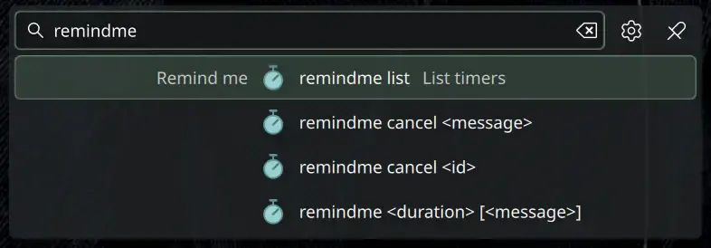

# RemindMe

A timer plugin for KDE Plasma 6 to create, list, and cancel timers from KRunner with optional message and snooze.




## Install

From the KDE Store, inside KRunner:

1. Open *System Settings → Search → Plasma Search*.
2. Click *Get New Plugins…*.
3. Search for *RemindMe* and click *Install*.
4. Restart KRunner so it loads the new plugin: log out and back in, or run `systemctl --user restart plasma-krunner.service`. KRunner reads the plugin list only at startup, so a new plugin does not appear before this.

### Manual install from archive

Download from <https://store.kde.org/p/2379079> then:

```sh
mkdir -p ~/.local/share/krunner-sources
rm -rf ~/.local/share/krunner-sources/remindme-* # drop previous extractions, if any
tar xzf ~/path/to/remindme-*.tar.gz -C ~/.local/share/krunner-sources
krunner-plugininstaller install ~/.local/share/krunner-sources/remindme-*
systemctl --user restart plasma-krunner.service
```

> [!NOTE]
> Optionally, make RemindMe a favorite and move it above others via *System Settings → Search → Plasma Search*.

## Usage

Trigger words: `remindme` or `rme`.

| Action                | Query                 |
| --------------------- | --------------------- |
| Create timer          | `rme 5`, `rme 3h msg` |
| List active timers    | `rme list`            |
| Cancel by id          | `rme cancel 3`        |
| Cancel by message     | `rme cancel meeting`  |
| List timers to cancel | `rme cancel`          |
| Usage / help          | `rme`                 |

Selecting a listed timer opens one *Reminders* window with every active timer, each row with its due time, Snooze and Cancel timer.

While any timer waits, a tray icon appears too: clicking it opens the same *Reminders* window, and its tooltip shows when the next reminder is due.

| Input          | Meaning                             |
| -------------- | ----------------------------------- |
| `rme 5`        | 5 minutes                           |
| `rme 5.5`      | 5 minutes 30 seconds                |
| `rme .5`       | 0.5 minutes = 30 seconds            |
| `rme 0:20`     | 20 seconds                          |
| `rme 20s`      | 20 seconds                          |
| `rme 4h`       | 4 hours                             |
| `rme 5:30`     | 5 minutes 30 seconds                |
| `rme 4:15:30`  | 4 hours 15 minutes 30 seconds       |
| `rme 8 pasta!` | 8 minutes with the message `pasta!` |

---

## Technical

### Development

Requirements: C++20 compiler, CMake 3.29+, Qt 6.9+, KDE Frameworks 6, Extra CMake Modules, `gettext` and `just`. Tests also need Qt `Test`.

```sh
just --list               # list available recipes

just                      # Verify the repo: lint, format check, then configure, build and test.
just build                # Build a configured preset
just check                # Verify the repo: lint, format check and the full ci workflow
just ci                   # Configure, build and test in one command
just clean                # Remove all build trees
just doctor               # Report which optional tools are missing
just format               # Format C++ sources and shell scripts in place
just format-check         # Fail if C++ or shell sources are not formatted
just install              # Install a built preset
just lint                 # Run every available linter; missing tools and not-yet-added configs are skipped
just package              # Build the KDE Store payload (prebuilt binary per architecture, in a container)
just pot                  # Extract translatable strings into po/krunner_remindme.pot
just release              # Bump the version from conventional commits and tag it.
just reload               # Configure, build, reinstall and relaunch KRunner with the local runner
just test                 # Run the test suite
just tidy                 # Run clang-tidy over project sources
```

### Install from source

```sh
just reload             # configure, build, install into ~/.local, restart KRunner
```

Uninstall: `bash packaging/uninstall.sh`.

---

## License

[GPL-3.0-or-later](LICENSE).
